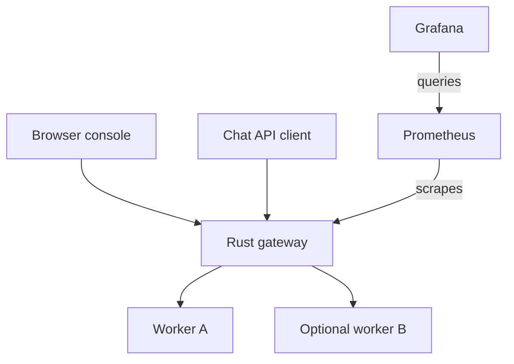

# InferenceForge design

## Goal and boundaries

A chat request can occupy a model worker for much longer than an ordinary HTTP request. The gateway limits how much generation it admits, selects a worker, and carries the admission permit through the final response bytes. Workers own model execution. A reviewer can exercise the same gateway against deterministic workers or an actual CPU inference engine.



## Admission and memory

1. Authenticate the inference route before reading its JSON body. A bearer key comparison uses constant-time byte equality. The body extractor caps incoming JSON at 1 MiB.
2. Validate the configured model, nonempty text messages and boolean streaming flag. The demo handles text chat. The inference engine validates any additional generation parameters.
3. Consume one token from the replica's request bucket. An empty bucket returns 429. A later capacity rejection still consumes this token.
4. Acquire an execution permit immediately or reserve a slot in the bounded waiting room. A full room or expired queue deadline returns 503. A waiting client that leaves drops its slot and queue gauge.
5. Recheck the drain flag after admission. Once admitted, JSON responses are read incrementally into a buffer capped at 2 MiB and checked for valid JSON. SSE pulls chunks on downstream demand. Each stream owns its permit until its body is dropped.

Rust RAII guards pair metric updates with resource release across success, errors and cancellation. The active gauge measures upstream work through the JSON body read or the lifetime of an SSE response body. Socket buffers, idle inbound connections and simultaneous pre-admission uploads require separate edge limits.

## Routing and replay

An atomic counter rotates the starting worker. A single pass can inspect each configured worker once. The HTTP client disables redirects and automatic retries. The client key stays at the gateway. A separately configured upstream key can be sent to the trusted worker origins.

| Observation | Gateway decision |
| --- | --- |
| Worker circuit is open or a recovery probe already owns it | Try the next eligible worker. |
| Connection could not be established | Count a failure. Try the next eligible worker within the shared budget. |
| Upstream returned 5xx | Count a failure and return 502. Work may already have run. |
| Upstream returned a rejection | Return 502 with the upstream status. A 4xx demonstrates connectivity and clears a health failure. |
| Header deadline expired | Count a failure, return 504 and stop. |
| JSON body is invalid, oversized or interrupted | Count a failure and return 502. A body timeout returns 504. |
| Stream fails after headers were committed | Abort the body, increment the stream error counter for a transport/timeout error, and release capacity. The console detects a missing completion sentinel. |
| All workers exhausted | Return 503. |

A mutex protects each worker's failure count, circuit generation and recovery lease. Two counted failures in a row open the circuit for ten seconds. After cooldown, exactly one request can probe. A cancelled probe releases the lease. Stale results from an older circuit generation cannot close a newer open circuit. Recovery requires traffic. The stream circuit judges the initial SSE response headers. Body errors also have a separate metric.

## Time budgets

Queue wait has its own deadline. After admission, worker selection, headers, failover and body reads share a total generation budget. Each read also applies the relevant stage timeout. SSE idle time measures the gap while waiting for upstream bytes, including keepalives. The gateway forwards SSE transparently. The browser parses complete events and measures first nonempty content using a monotonic clock.

| Setting | Native binary default | Purpose |
| --- | ---: | --- |
| MAX_INFLIGHT | 16 | Active generation slots. Native demo and Compose use 4. |
| MAX_WAITING | 8 | Waiting slots, 0 enables immediate shedding. Demo uses 2. |
| QUEUE_WAIT_MS | 150 | Maximum time spent waiting for an active slot. |
| RATE_LIMIT_RPS / RATE_LIMIT_BURST | 100 / 30 | Per-process arrival quota. |
| HEADER_TIMEOUT_MS | 5000 | Maximum wait for upstream headers per attempt. |
| BODY_TIMEOUT_MS | 30000 | Maximum JSON body read time. |
| STREAM_IDLE_MS | 10000 | Maximum wait for the next upstream chunk. |
| GENERATION_BUDGET_MS | 120000 | Shared wall-clock deadline checked while upstream work is polled. |

HTTP backpressure can pause body polling while a client stops reading. An edge downstream-write timeout complements these upstream deadlines. Dropping the Rust response closes the upstream connection. The actual serving engine determines when GPU or CPU generation stops.

## Observability and incident response

| Signal | Interpretation and action |
| --- | --- |
| 429 rises, spare slots exist | Inspect request arrival bursts. Check the local token bucket before adding workers. |
| 503 and queued work rise | Compare active permits, queue-full and queue-timeout outcomes. Inspect worker service times. |
| Worker A circuit opens | Inspect labeled backend attempts. Restore A and send a request after cooldown to exercise a probe. |
| Streams start but output disappears | Compare stream errors, client cancellation and missing completion markers. Check the upstream directly with the same chat payload. |
| Grafana has no data | Use `python3 scripts/check_monitoring.py` against Compose. It checks Prometheus samples, the provisioned dashboard and the actual Grafana data-source query. |

The duration histogram starts at admission. Client measurements include queueing and transport. The UI's first content delay includes HTTP and browser scheduling. True model TTFT requires model-token instrumentation. The dashboard uses fixed-cardinality labels. Request IDs live in logs and response headers. Prompts, bearer keys and generated answers are excluded from request logs. Logs and metrics cover this reference deployment. Cross-service trace export would require instrumented workers and an OTLP collector.

## Kubernetes and shutdown

The container runs as UID 10001. The manifests create separate Deployments and Services for A, B and the gateway, with resource limits and readiness/liveness probes. The Kubernetes example deploys the serving tier. The default Compose stack also runs monitoring.

```bash
docker build -t inferenceforge:local .
kind create cluster --name forge
kind load docker-image inferenceforge:local --name forge
kubectl --context kind-forge create secret generic inferenceforge-auth --from-literal=api-key=local-demo-key
kubectl --context kind-forge apply -f k8s/all.yaml
kubectl --context kind-forge rollout status deployment/inference-gateway
kubectl --context kind-forge port-forward service/inference-gateway 8007:8001
```

The liveness probe reports process health. Readiness reflects admission/drain state and avoids tying gateway restarts to upstream availability. On SIGTERM the gateway stops accepting new work and allows active responses to drain for up to 20 seconds. The Pod termination grace period is 30 seconds. The HTTP suite sends SIGTERM during a stream and verifies the completion marker before exit.

The optional CPU HPA in `k8s/hpa.yaml` requires metrics-server. Per-replica quotas, queues and worker health views are independent. Increasing gateway replicas multiplies admission capacity while model compute stays fixed. Production deployments need worker-side capacity limits, tenant identity, coordinated quotas, transport security, network isolation for telemetry and measured rollout behavior under sustained load. Use the [benchmark evidence](docs/benchmarking.md) to see where the demo saturates.
