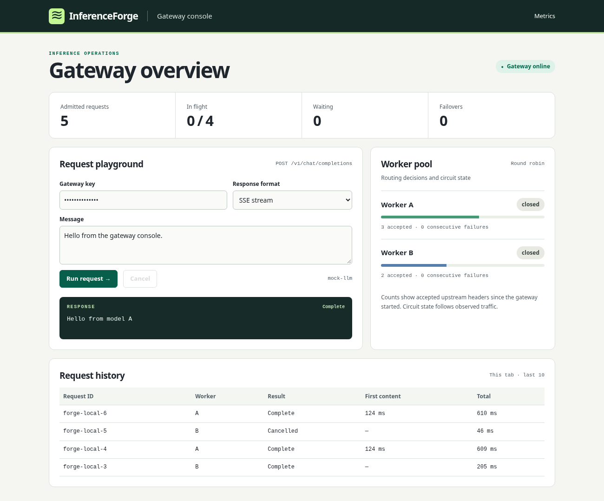

# InferenceForge

[](https://github.com/sivajisj2/InferenceForge/actions/workflows/ci.yaml)

A Rust inference gateway with a live operator console, streaming chat, bounded admission and two-worker failover. Run the failure drills on a laptop, then point the same gateway at a real model server. The same Rust endpoint also served SmolLM2 on a CPU through llama.cpp.

**A result you can reproduce.** With four generation slots and a simulated 200 ms worker, the gateway completed all 60 requests at 19.65 completions/s with four concurrent clients. With twelve clients it shed 56 of 60 attempts. [Workload, latency percentiles and raw measurements](docs/benchmarking.md).



## Run the demo

With a stable Rust toolchain, a C compiler, Make and Bash on Linux or macOS, run the following from the repository root.

```bash
make demo
```

Open **http://127.0.0.1:8007** and use the local demo key `local-demo-key`. Send a streamed request, switch to JSON, then cancel another stream. The console reads live worker state from the gateway and records the selected worker, first content delay and total elapsed time. The default workers return deterministic greetings for any prompt. Ctrl-C stops all three native processes. The launcher uses Bash 4.3 or newer.

### Start all five services with Docker Compose

```bash
make up
bash scripts/smoke_test.sh
make drill
python3 scripts/check_monitoring.py
make down
```

| Service | Address or role |
| --- | --- |
| Gateway and console | http://127.0.0.1:8007 |
| Worker A and worker B | Private Compose network, ports 9000 and 9001 |
| Prometheus | http://127.0.0.1:9097/targets |
| Grafana | http://127.0.0.1:3007 · local login `admin` / `local-demo-admin` · dashboard **InferenceForge • Gateway operations** |

Copy `.env.example` to `.env` to override Compose credentials and host ports. Export the same key and port settings when running client scripts. The loopback bindings and example credentials are intended for local use.

## What to inspect

| Engineering question | Implementation and evidence |
| --- | --- |
| What happens when generation slots fill up? | A token bucket limits arrival rate. Semaphores cap active and waiting requests. Compare the [measured overload runs](docs/benchmarking.md). |
| Can failover duplicate expensive work? | The gateway tries another worker only after a connect failure or when a circuit skips a worker. A timeout, upstream 5xx or interrupted response ends the request. See [routing decisions](DESIGN.md). |
| Does a stream keep consuming capacity after disconnect? | A Rust drop guard owns the permit for the response body. The [HTTP integration suite](scripts/integration_test.py) drives cancellation, saturation and shutdown through real sockets. |
| Can it forward actual inference? | The [CPU model walkthrough](docs/real-model.md) includes pinned weights, a tested worker version, and JSON and SSE evidence. |
| How do I operate it? | [Design and runbook](DESIGN.md) covers probes, telemetry, limits and Kubernetes deployment. The [CI workflow](.github/workflows/ci.yaml) exercises Compose, Grafana queries and a kind rollout. |

## Call the API

```bash
curl -N http://127.0.0.1:8007/v1/chat/completions \
  -H 'Authorization: Bearer local-demo-key' \
  -H 'Content-Type: application/json' \
  -d '{"model":"mock-llm","stream":true,"messages":[{"role":"user","content":"Hello"}]}'
```

Set `"stream":false` for JSON. Successful responses include `x-backend`, `x-failover` and `x-request-id`. The streaming client treats `[DONE]` as the completion marker. The supported chat subset accepts text messages with user, assistant and system roles.

## Verify locally

```bash
make check     # Formatting, strict Clippy, Rust unit tests
make test      # Starts isolated processes and runs eight HTTP integration tests
make benchmark # Run against a separately started demo
```

The HTTP suite uses Python 3.9+ and the standard library. It includes controlled connection failures, a worker 500, header and stream deadlines, a full waiting room, a cancelled client, recovery probes and SIGTERM during generation.

**Project scope.** InferenceForge manages traffic around inference workers. Model execution belongs to the upstream engine. Quotas and breakers are per gateway replica. GPU capacity planning, multi-tenant accounting and distributed trace export remain open work.
